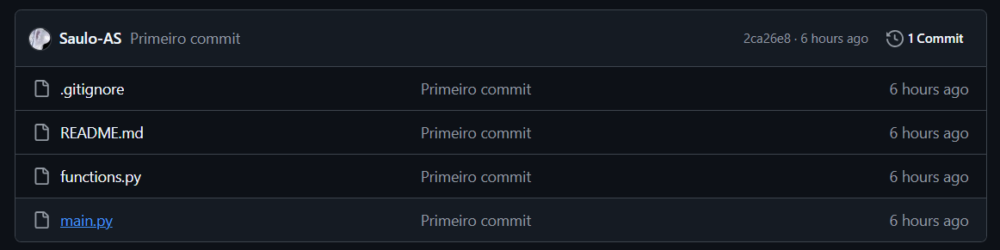
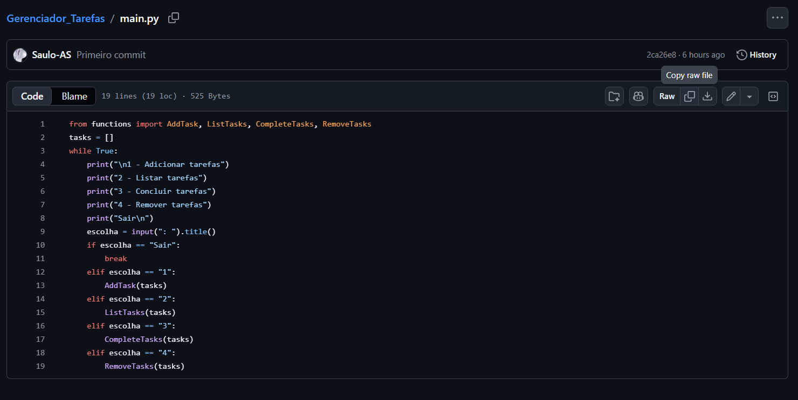

# Gerenciador de Tarefas em Python. v0.0.0
## Um gerenciador de tarefas em desenvolvimento, agindo ainda em linhas de comando
### suas funções são:
- Adicionar
- Listar
- Concluir
- Excluir
# Como obter os códigos na sua máquina.
## Primeiro, clique no arquivo: 

## Após isso, copie o codigo:

>Cique em "Copy raw file" para copiar o código.

>**Certifique-se de fazer esses passos tbm para functions.py, sem ele o programa não funciona!**

## Por fim, guarde os códigos em arquivos separados. Os arquivos precisam estar na mesma pasta raiz.
```text
pasta_raiz
    |
    ├── main.py
    └── functions.py
```
# Como executar:
>**Certifique-se de ter o Python 3 instalado em sua máquina.**
## Se estiver usando o Visual Studio Code, apenas clique no botão "Run Python File" e rode apenas o main.py.
## Se estiver no Windows (CMD / PowerShell):
```bash
python main.py
```
## Se estiver no macOS / Linux (Terminal):
```bash
python3 main.py
```
